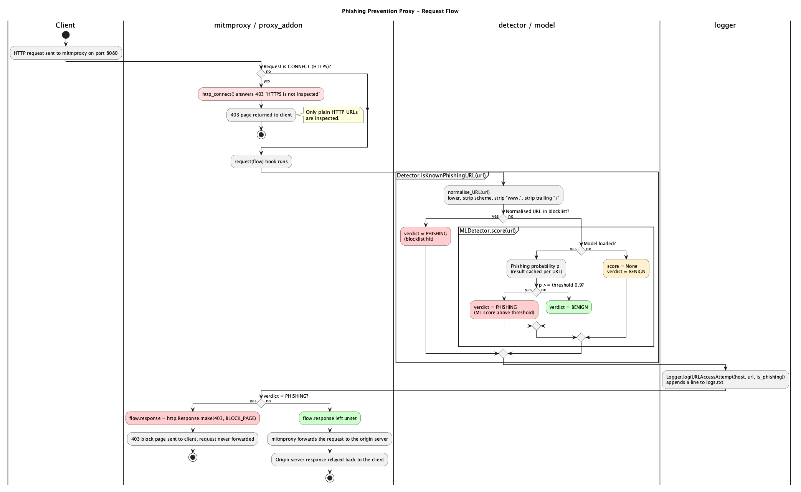
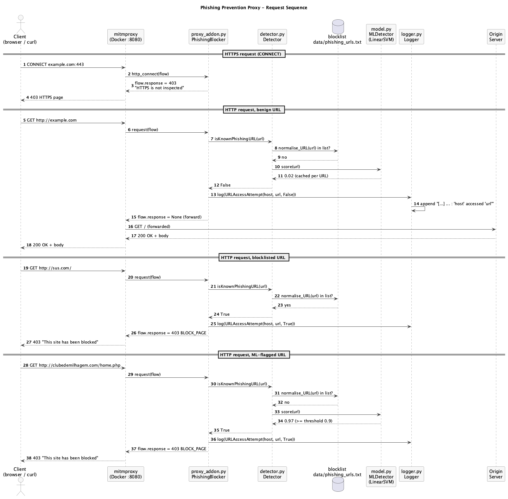
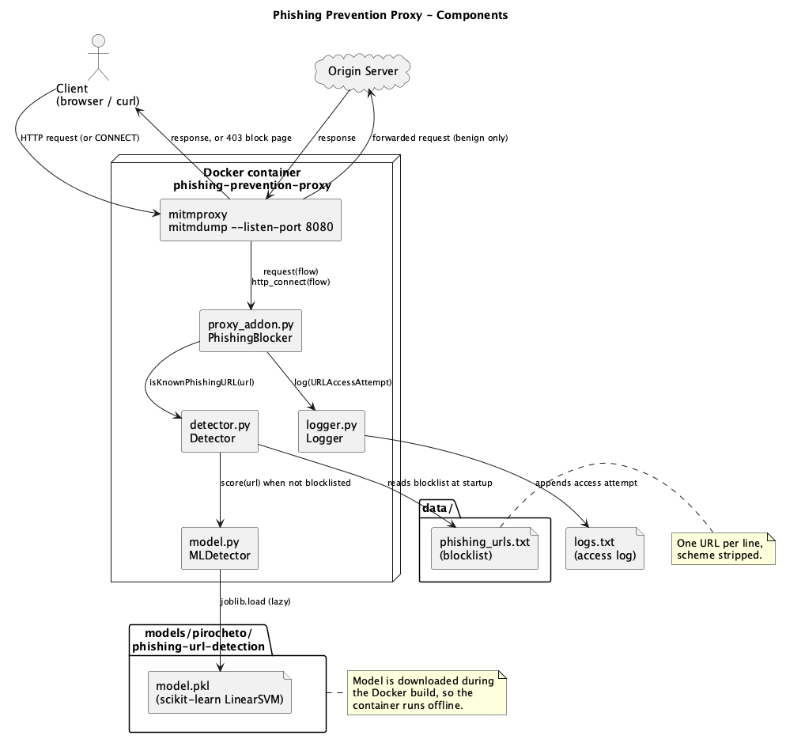

# CSCI262-Assignment-3

A phishing prevention proxy. Requests pass through the proxy, where each URL is
checked against a blocklist of known phishing URLs and a scikit-learn ML model.
Phishing URLs get a `403` block page instead of being forwarded.

## How it works

```
browser/curl  ──►  mitmproxy (Docker, port 8080)  ──►  origin server
                       │
                       ├─ lib/proxy_addon.py   inspects each request
                       ├─ lib/detector.py      blocklist check + ML score
                       ├─ lib/model.py         scikit-learn model (HuggingFace)
                       └─ lib/logger.py        writes logs.txt
```

- **Not phishing:** the addon does nothing, mitmproxy forwards the request and
  relays the response back to the client.
- **Phishing:** the addon returns a `403` page directly, the request is never
  forwarded.
- **HTTPS (`CONNECT`):** rejected with a `403` explanation — this demo only
  inspects plain HTTP URLs.

## Diagrams

The flow is documented with [PlantUML](https://plantuml.com/) sources in
`docs/`, with rendered images next to them.

| Diagram | Source | Image |
| --- | --- | --- |
| Request flow (activity diagram) | [`docs/flow.puml`](docs/flow.puml) |  |
| Request sequence | [`docs/sequence.puml`](docs/sequence.puml) |  |
| Components | [`docs/component.puml`](docs/component.puml) |  |

Regenerate the images after editing a `.puml` file:

```bash
plantuml -tpng docs/*.puml                            # needs Graphviz for layout
plantuml -tpng -Playout=smetana docs/*.puml           # pure-Java fallback
```

## Run the demo with Docker

```bash
docker build -t phishing-prevention-proxy .
docker run --rm -p 8080:8080 phishing-prevention-proxy
```

The ML model is downloaded during the build, so the container needs no network
at runtime.

### Test it with curl

```bash
# Benign URL -> passes through, real page comes back (200)
curl -x http://127.0.0.1:8080 http://example.com

# Blocklisted URL -> 403 block page
curl -x http://127.0.0.1:8080 http://sus.com/

# ML-flagged URL -> 403 block page
curl -x http://127.0.0.1:8080 http://clubedemilhagem.com/home.php

# HTTPS is not inspected -> CONNECT tunnel refused
curl -x http://127.0.0.1:8080 https://example.com
```

### Test it with a browser

1. Start the container (see above).
2. In Firefox: Settings → General → Network Settings →
   Manual proxy configuration → HTTP Proxy `127.0.0.1`, port `8080`.
3. Visit `http://sus.com` (blocked) or `http://example.com` (loads normally).

### Logs

Every access attempt is recorded in `logs.txt` (inside the container at
`/app/logs.txt`):

```
[!!!] [2026-10-19 01:11:59+11:00]: 'sus.com' accessed 'http://sus.com/'
[...] [2026-10-19 01:11:46+11:00]: 'example.com' accessed 'http://example.com/'
```

Run `docker logs phishing-proxy-demo` to watch requests as they happen.

## Configuration

- **Blocklist:** `data/phishing_urls.txt`, one URL per line (scheme-stripped).
- **ML threshold:** `Detector(..., threshold=0.9)` in `lib/detector.py`.
- **Block page:** `BLOCK_PAGE` in `lib/proxy_addon.py`.

## Local development

```bash
uv sync
uv run python test_driver.py     # try the detector interactively
uv run mitmdump -s lib/proxy_addon.py   # run the proxy without Docker
```

## Limitations

- Only plain HTTP URLs are inspected; HTTPS traffic cannot be inspected without
  a man-in-the-middle certificate, so `CONNECT` tunnels are rejected instead.
- The ML model can produce false positives/negatives; the threshold in
  `lib/detector.py` balances this.
